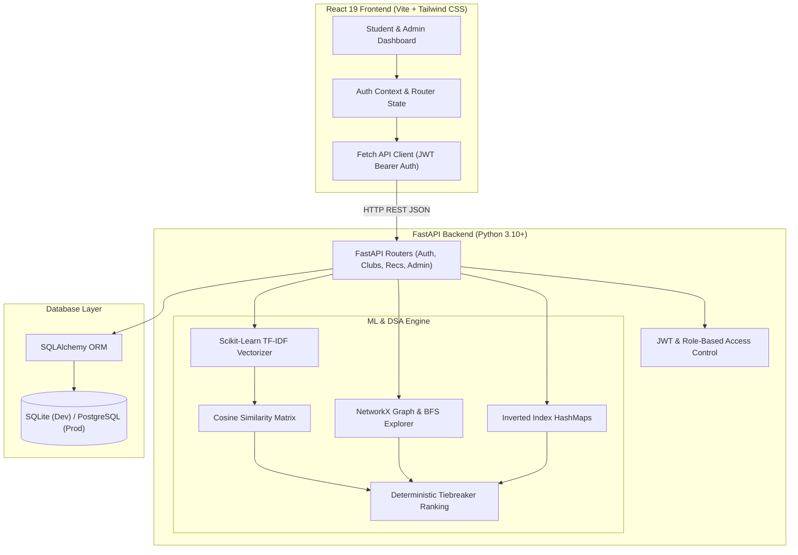

## CampusConnect - College Club Recommendation System

<p align="center">


[](https://fastapi.tiangolo.com)
[](https://www.python.org/)
[](https://react.dev/)
[](https://scikit-learn.org/)
[](https://networkx.org/)
[](https://tailwindcss.com/)
[](https://pytest.org/)

An advanced, production-ready college project named **"College Club Recommendation System" (CampusConnect)**. The system intelligently recommends extracurricular university clubs to students based on their multi-select interests, skills, academic major, and preferred activities.

The system combines **Machine Learning Content-Based Filtering** (TF-IDF vectorization and Cosine Similarity) with **Data Structures & Algorithms** (NetworkX Breadth-First Search graph proximity, HashMap inverted indices, Set intersection, and deterministic tie-breaking).

---

## Architecture Diagram



---

## Core Features

### 🎓 Student Features
- **Student Authentication**: Secure registration, login, session refresh, and logout using salted `bcrypt` hashing and signed JWT tokens.
- **Academic Profile**: Department, graduation year, personal bio, skills tags, and multi-select extracurricular passions.
- **Multi-Select Interests**: Artificial Intelligence, Machine Learning, Coding, Web Development, Robotics, Data Science, Photography, Music, Dance, Sports, Debate, Public Speaking, Entrepreneurship, Design, Gaming, Cybersecurity, Finance & Trading, and more.
- **Personalized Recommendations**: Relevance Match Score (0–100%) with transparent explainability ("Why this club was recommended").
- **Club Directory**: Full search by keyword, filter by category tabs (Technology, Arts, Sports, Entrepreneurship, Communication, Community).
- **Club Details**: Meeting schedules, locations, faculty advisor / club leads, official contact email, and active membership count.
- **Saved Favorites**: One-click bookmarking to save clubs for later.
- **Membership Applications**: Submit join requests with custom introductory notes to club officers and track status in real-time (`pending`, `approved`, `declined`).
- **Recommendation Feedback**: 5-star rating, helpfulness classification, and qualitative comments to calibrate recommendation accuracy.

### 👑 Administrator Features
- **Admin Intelligence Hub**: Protected by server-side Role-Based Access Control (`role == 'admin'`).
- **Club Lifecycle Management**: Add new clubs, edit descriptions and schedules, update interest tags, and safely deactivate or delete clubs.
- **Membership Management**: Review incoming student join applications; one-click Approve or Reject with instant database status persistence.
- **Analytics & Popular Interests**: Frequency distribution of campus student interests and club categories.
- **NetworkX Graph Topology**: Real-time monitoring of knowledge graph node counts, edge counts, density, and connected components.
- **Registered Students Directory**: Overview of all enrolled student members.

---

## Machine Learning & DSA Implementation

### 1. Scikit-Learn TF-IDF & Cosine Similarity
- Normalizes club mission text, required skills, and activities.
- Fits `TfidfVectorizer(ngram_range=(1, 2), stop_words='english', sublinear_tf=True)`.
- Transforms the student profile into a query vector and calculates cosine similarity against all active club vectors:
$$\text{Sim}_{\text{TF-IDF}}(\mathbf{s}, \mathbf{c}) = \frac{\mathbf{s} \cdot \mathbf{c}}{\|\mathbf{s}\|_2 \|\mathbf{c}\|_2}$$

### 2. NetworkX Knowledge Graph & BFS Traversal
- **Graph Representation**: Multi-type graph with Club nodes, Interest nodes, Skill nodes, and Category nodes.
- **Semantic Cross-Bridges**: AI $\leftrightarrow$ Machine Learning $\leftrightarrow$ Data Science, Design $\leftrightarrow$ Web Dev, Debate $\leftrightarrow$ Public Speaking.
- **Breadth-First Search (BFS)**: Explores reachable active clubs from user interest seed nodes up to depth 2:
  - Depth 1 (Direct interest neighbor): weight $1.0$
  - Depth 2 (Related interest or category neighbor): weight $0.5$
  - Automatically avoids inactive clubs.

### 3. HashMap Inverted Index
- Maintains `Dict[str, Set[int]]` mapping normalized interest and skill names to candidate club IDs.
- Provides $O(1)$ candidate retrieval without scanning the entire club database.

### 4. Sets & Jaccard Overlap
- Computes student interest set intersection with club interest tags in $O(\min(|S|, |C|))$.
- Computes Jaccard index: $\frac{|S \cap C|}{|S \cup C|}$.

### 5. Composite Relevance Score & Tie-Breaking
$$\text{Relevance Score} = 100 \times (0.50 \cdot \text{TF-IDF} + 0.35 \cdot \text{Overlap} + 0.15 \cdot \text{Graph BFS})$$
Deterministic tie-breaking sorts primarily by descending score, secondarily by number of matched interests, and tertiarily by club name alphabetically.

---

## Project Structure

```
college-club-recommendation-system/
├── backend/
│   ├── app/
│   │   ├── config.py             # Settings, JWT config, ML weights
│   │   ├── database.py           # SQLAlchemy engine & session factory
│   │   ├── main.py               # FastAPI entrypoint, middleware, routers
│   │   ├── models.py             # 10 Database tables & relationships
│   │   ├── schemas.py            # Pydantic validation models
│   │   ├── security.py           # Bcrypt hashing, JWT tokens & RBAC
│   │   ├── routers/
│   │   │   ├── admin.py          # Admin analytics & club/member review
│   │   │   ├── auth.py           # Register, login, profile endpoints
│   │   │   ├── clubs.py          # Catalog, search, details
│   │   │   ├── favorites.py      # Bookmarks CRUD
│   │   │   ├── feedback.py       # Recommendation ratings
│   │   │   ├── memberships.py    # Join applications workflow
│   │   │   └── recommendations.py# ML & Graph recommendation route
│   │   └── services/
│   │       ├── graph_engine.py   # NetworkX Graph & BFS traversal
│   │       ├── ranking.py        # HashMap index & tiebreaker
│   │       └── recommender.py    # Content-based ML engine
│   ├── scripts/
│   │   ├── create_admin.py       # Secure first-admin creator script
│   │   └── seed.py               # 18 realistic sample clubs & demo users
│   ├── tests/
│   │   ├── test_api.py           # API integration tests
│   │   ├── test_graph.py         # NetworkX BFS unit tests
│   │   └── test_recommender.py   # TF-IDF, Overlap & ranking tests
│   └── requirements.txt          # Python dependencies
├── frontend/
│   ├── src/
│   │   ├── api/                  # Modular Fetch API client
│   │   ├── components/           # Navbar, Footer, ClubCard, Modals, Selector
│   │   ├── context/              # AuthContext (JWT session state)
│   │   ├── pages/                # 15 Complete application views
│   │   ├── App.jsx               # Client router & navigation layout
│   │   ├── index.css             # Tailwind base & custom design tokens
│   │   └── main.jsx              # React 19 entrypoint
│   ├── package.json
│   ├── tailwind.config.js
│   ├── postcss.config.js
│   └── vite.config.js
├── database/
│   └── schema.sql                # Full SQL DDL schema documentation
├── docs/
│   ├── API_DOCUMENTATION.md      # Detailed REST API specification
│   ├── ARCHITECTURE.md           # System design & Mermaid diagrams
│   └── ML_AND_DSA_EXPLANATION.md # Mathematical & algorithmic breakdown
├── .env.example
├── .gitignore
├── docker-compose.yml
├── start.bat                     # Windows 1-click startup
├── start.sh                      # macOS/Linux 1-click startup
└── README.md
```

---

## Quick Start Guide

### Prerequisites
- **Python 3.10+** (Tested on Python 3.10, 3.11, 3.14)
- **Node.js 18+** (Tested on Node.js v25 / v20)
- **Git** (optional)

---

### Option A: Windows 1-Click Launch
Double-click `start.bat` or run in PowerShell:
```powershell
.\start.bat
```
This automatically checks dependencies, seeds the database with 18 clubs and demo accounts, and launches both backend and frontend servers in separate terminal windows.

---

### Option B: macOS / Linux 1-Click Launch
```bash
chmod +x start.sh
./start.sh
```

---

### Option C: Manual Setup

#### 1. Setup Backend
```bash
cd backend
python -m venv venv

# On Windows:
.\venv\Scripts\activate
# On macOS/Linux:
source venv/bin/activate

pip install -r requirements.txt

# Seed the database with 18 clubs, demo student & admin
python scripts/seed.py

# Start the FastAPI server
uvicorn app.main:app --host 127.0.0.1 --port 8000 --reload
```
API Documentation will be live at `http://127.0.0.1:8000/docs`.

#### 2. Setup Frontend
In a new terminal window:
```bash
cd frontend
npm install
npm run dev
```
Open `http://localhost:5173` in your browser.

---

## Demo Credentials

| Role | Email Address | Password | Capabilities |
|---|---|---|---|
| **Demo Student** | `student@university.edu` | `Student@College2026` | Personalized feed, request to join, save favorites, rate recommendations |
| **Demo Admin** | `admin@university.edu` | `Admin@College2026` | Admin Intelligence Hub, approve/reject memberships, create/edit clubs |

*(Quick login buttons are also available on the Login page for one-click demonstration).*
📁 Project Structure Note

The project follows a modular architecture with separate folders for the backend, frontend, database, and documentation. Generated files, local databases, and environment configurations may vary depending on your local setup.

⚙️ Installation & Setup
📋 Prerequisites

Make sure the following tools are installed:

Python 3.10 or newer
Node.js 18 or newer
npm
Git (optional)
Docker and Docker Compose (optional)
🪟 Option 1: Windows Quick Start

From the project root, run:

powershell
.\start.bat


The startup script is designed to prepare the application environment, initialize sample data, and launch the backend and frontend services.

🐧 Option 2: macOS / Linux Quick Start
bash
chmod +x start.sh
./start.sh

⚙️ Option 3: Manual Installation
Step 1: Set Up the Backend

Navigate to the backend directory and create a virtual environment:

bash
cd backend
python -m venv venv


Activate the virtual environment.

Windows PowerShell:

powershell
.\venv\Scripts\Activate.ps1


macOS / Linux:

bash
source venv/bin/activate


Install dependencies and initialize the sample database:

bash
python -m pip install -r requirements.txt
python scripts/seed.py


Start the FastAPI development server:

bash
uvicorn app.main:app --host 127.0.0.1 --port 8000 --reload

Step 2: Set Up the Frontend

Open a second terminal and run:

bash
cd frontend
npm install
npm run dev

🌐 Local Application URLs
Service	URL
Frontend Application	http://localhost:5173
Backend API	http://127.0.0.1:8000
Interactive API Documentation	http://127.0.0.1:8000/docs
Note: Start the backend before using frontend features that require API access.
🔑 Demo Credentials

After initializing the sample database with the provided seed script, the following demo accounts are intended to be available.

Role	Email	Password
🎓 Student	student@university.edu	Student@College2026
👑 Administrator	admin@university.edu	Admin@College2026
Access Privileges
🎓 Student: Explore clubs, receive personalized recommendations, save favorites, submit membership applications, and rate recommendations.
👑 Administrator: Manage clubs, review membership applications, and access administrative analytics.
🔒 Security Notice: These are development-only demonstration credentials. Replace them and disable demo access before public deployment. If these credentials have been exposed in a public repository, rotate them.
🧪 Testing & Quality Assurance

CampusConnect includes automated tests covering API functionality, graph traversal, recommendation scoring, and deterministic ranking.

Backend Tests

Run the following command from the project root:

bash
cd backend
python -m pytest -v


The documented test suite contains 12 tests covering the following areas:

Test Area	Coverage
API Integration	Health check, login and token generation, recommendations, club directory, and admin access protection
Graph Engine	Graph construction, BFS traversal, and graph analytics
Recommendation Engine	Text normalization, set overlap, deterministic tie-breaking, active-club filtering, and empty-interest fallback
Frontend Production Build

Run the following commands:

bash
cd frontend
npm install
npm run build


A successful build generates optimized production assets in the dist/ directory.

Verification Note: The results above are based on the supplied project documentation. Run the commands locally to verify the current state of your checkout.
🐳 Docker Deployment

If Docker and Docker Compose are configured, build and start the application using:

bash
docker compose up --build -d

Service Endpoints
Service	URL / Port
Frontend	http://localhost:5173
Backend API	http://localhost:8000
FastAPI Swagger UI	http://localhost:8000/docs
PostgreSQL	5432 (if exposed by the Compose configuration)
Production Tip: Configure environment variables, persistent database storage, restricted network access, HTTPS, and reverse-proxy settings before deploying publicly.
📚 API Documentation

CampusConnect provides RESTful APIs powered by FastAPI.

Explore the interactive Swagger UI:

Open FastAPI API Documentation

The API is organized into the following modules:

🔐 Authentication and student profiles
🏢 Club discovery, search, and details
🤖 Personalized recommendations
❤️ Favorite clubs
📨 Membership applications
⭐ Recommendation feedback
👑 Administrative management and analytics

For detailed endpoints, request schemas, and response examples, refer to docs/API_DOCUMENTATION.md.

🚀 Future Enhancements

Potential improvements for future versions include:

📱 Develop a mobile-friendly Progressive Web App (PWA).
🧠 Improve recommendations using student feedback and interaction history.
📅 Integrate calendars for club events and meetings.
🔔 Add notifications for membership decisions and upcoming activities.
📊 Expand campus analytics and reporting dashboards.
🕸️ Introduce interactive graph visualization.
☁️ Implement cloud deployment and CI/CD automation.
🔍 Evaluate recommendations using Precision@K, Recall@K, and NDCG.
♿ Improve accessibility and expand automated frontend testing.
👨‍💻 Author

Gaurav Yadav

Student Developer | Machine Learning & Data Structures Enthusiast

CampusConnect is an academic software project demonstrating the integration of full-stack web development, Machine Learning, graph algorithms, and database-driven application design.

🎯 Areas of Interest
Python and Backend Development
Machine Learning and Recommendation Systems
Data Structures and Algorithms
Full-Stack Web Development
Graph Theory and Intelligent Search
📄 License

This project is intended to be distributed under the MIT License.

Ensure that the repository contains a valid LICENSE file with the MIT License text before claiming MIT licensing.

<p align="center">
<b>Built with 💙 by Gaurav Yadav</b>
<br/>
<i>Connecting Students with the Clubs They'll Love.</i>
</p>
</p>
