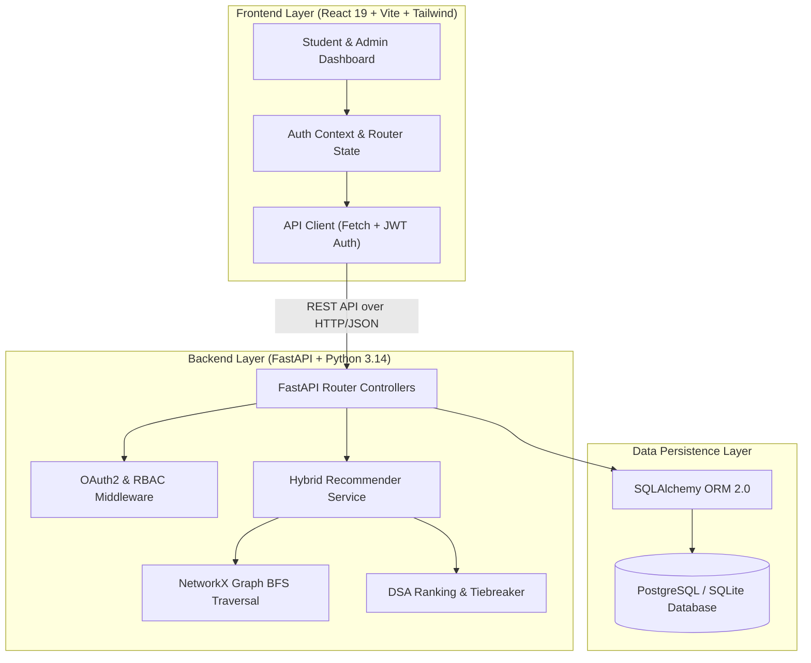
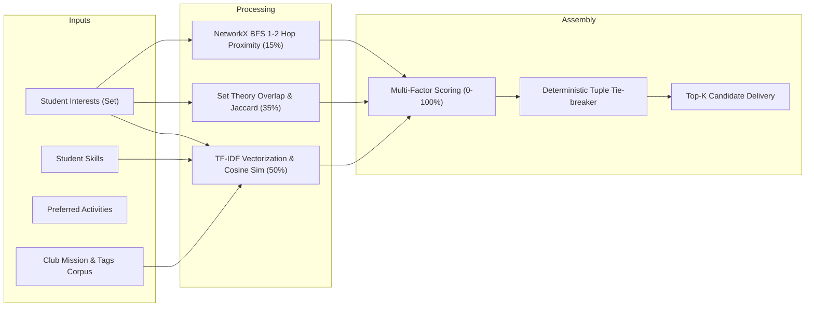

# CampusConnect Architecture & Design Document

## 1. System Architecture Overview

## 2. Recommendation Engine Architecture

## 3. Security & Role-Based Access Control (RBAC)

1. **Authentication Flow**:
   - Passwords hashed with `bcrypt` (salted work factor 12).
   - Session authenticated using JSON Web Tokens (JWT) signed with HMAC-SHA256.
   - Tokens contain user ID, subject email, and user role (`student` or `admin`).

2. **Role Enforcements**:
   - Ordinary students can only query public clubs, request memberships, and view/edit their own profiles and favorites.
   - Admin routes (`/api/admin/*`) strictly verify `current_user.role == 'admin'`, returning HTTP 403 Forbidden on violation.
